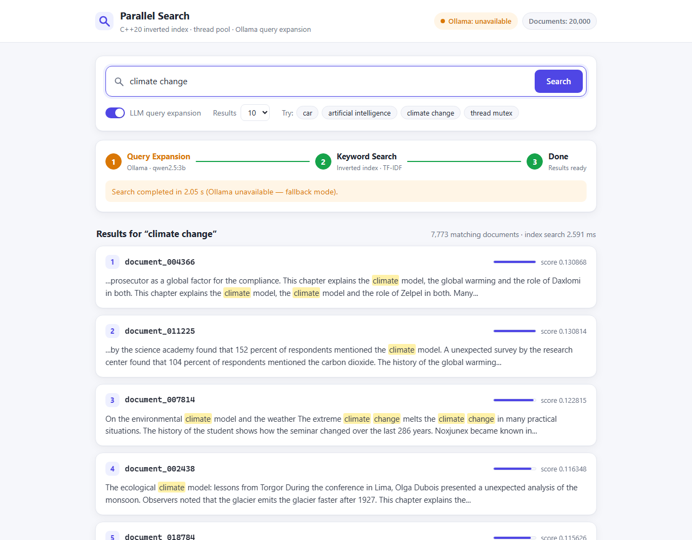
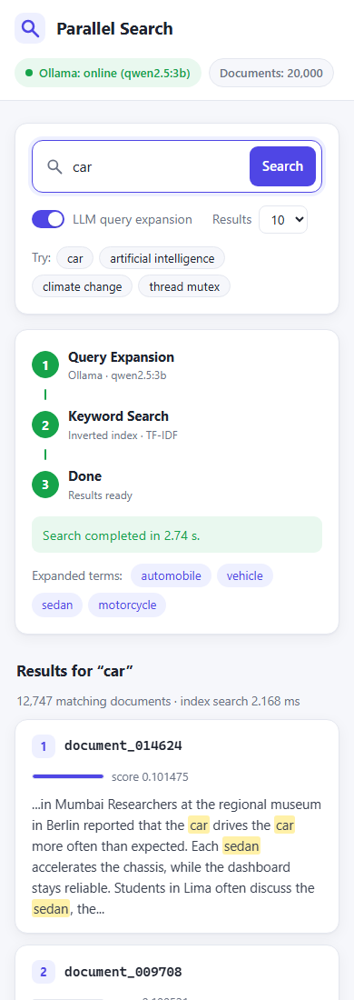
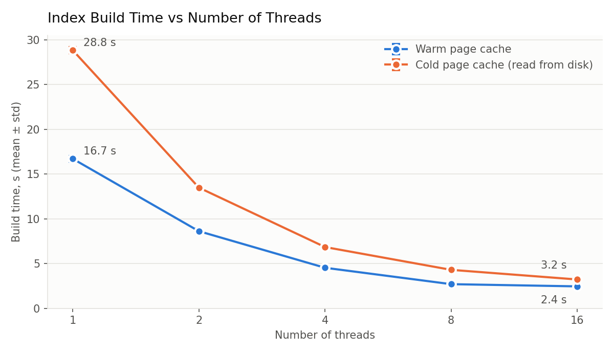
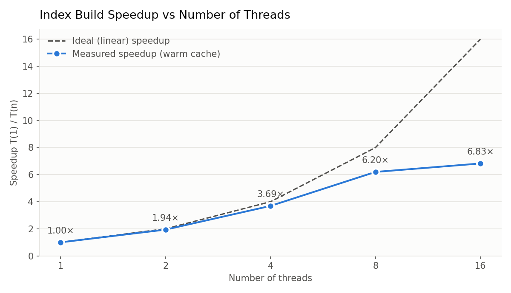
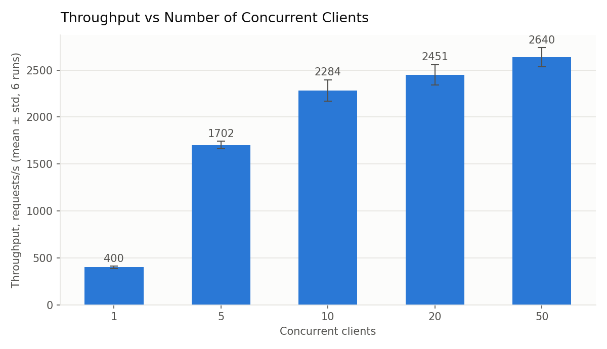

# Паралельна пошукова система з інтеграцією LLM

Курсова робота з дисципліни «Паралельні обчислення»:
**«Дослідження та реалізація паралельних обчислень на прикладі побудови пошукової системи з інтеграцією LLM»**.

Контейнеризована пошукова система на **C++20**. Вона паралельно будує власний інвертований індекс
за допомогою власного Thread Pool, обслуговує одночасні запити через REST API та WebSocket,
а для розширення запитів (Query Expansion) використовує локальну мовну модель **Ollama (qwen2.5:3b)**.

```bash
git clone https://github.com/riki1337228/course_work_parallel_computing.git
cd course_work_parallel_computing
docker compose up
# відкрити http://localhost:8080
```

---

## Зміст

1. [Проблема та мета](#1-проблема-та-мета)
2. [Можливості](#2-можливості)
3. [Архітектура](#3-архітектура)
4. [Технологічний стек](#4-технологічний-стек)
5. [Структура директорій](#5-структура-директорій)
6. [UML-діаграми](#6-uml-діаграми)
7. [Запуск через Docker Compose](#7-запуск-через-docker-compose)
8. [Датасет](#8-датасет)
9. [REST API](#9-rest-api)
10. [WebSocket API](#10-websocket-api)
11. [Ollama та Query Expansion](#11-ollama-та-query-expansion)
12. [Паралельна обробка: Thread Pool та інвертований індекс](#12-паралельна-обробка-thread-pool-та-інвертований-індекс)
13. [CLI-клієнт](#13-cli-клієнт)
14. [Web UI](#14-web-ui)
15. [Тестування](#15-тестування)
16. [Benchmark та результати](#16-benchmark-та-результати)
17. [Конфігурація](#17-конфігурація)
18. [Відомі обмеження](#18-відомі-обмеження)

---

## 1. Проблема та мета

**Проблема.** Пошук за ключовими словами у великому корпусі текстів (гігабайти) потребує попередньої
побудови індексу. Послідовна індексація займає десятки секунд, а сервер мусить одночасно обслуговувати
багатьох клієнтів. Звичайний keyword search не знаходить документи, у яких використано синоніми
(запит `car` не знайде `automobile`).

**Мета.** Розробити, протестувати та дослідити пошукову систему, яка:

- паралельно будує інвертований індекс власним Thread Pool і вимірює прискорення;
- потокобезпечно обслуговує одночасні запити;
- розширює запит синонімами за допомогою локальної LLM, а при відмові моделі продовжує працювати
  без розширення (fallback);
- запускається однією командою `docker compose up`.

## 2. Можливості

- Власний **ThreadPool** (`std::thread`, `std::mutex`, `std::condition_variable`, `std::future`).
- Власний **шардований інвертований індекс**: 64 шарди, по одному `std::shared_mutex` на шард.
- Паралельна індексація 20 000 документів (2.2 ГБ) за ~3.1 с на 8 потоках
  (17.9 с на одному потоці, прискорення ×5.9; на 16 потоках ×7.1).
- Ранжування **TF-IDF**, результати сортуються за спаданням `score`, з текстовими snippet-ами.
- **Query Expansion** через Ollama (`POST /api/generate`, JSON-режим) з тайм-аутом, валідацією
  відповіді та **fallback**.
- **REST API**: `GET /api/health`, `POST /api/index`, `POST /api/search`, `GET /api/stats`.
- **WebSocket** `/ws/search`: етапи `query_expansion → keyword_search → done`.
- **Ізоляція LLM (bulkhead):** пошуки з розширенням виконуються в окремому обмеженому пулі, тому повільна
  модель не затримує звичайний пошук; бюджет часу LLM рахується від надходження запиту.
- **CLI-клієнт** `search` (обгортки `./search` і `search.cmd` для хоста) та адаптивний **Web UI** з візуалізацією pipeline.
- Автоматична генерація датасету, завантаження моделі та побудова індексу в Docker Compose.
- 107 unit/concurrency тестів (також під ThreadSanitizer), 31 інтеграційний тест (HTTP + WebSocket + Ollama-клієнт),
  E2E-перевірка запущеного стеку (27 перевірок), benchmark із графіками.

## 3. Архітектура

```
                ┌──────────── search-server (C++20, Drogon) ─────────────┐
 Browser ──HTTP/WS──►  Drogon IO threads (event loops, IO_THREADS=4)      │
 CLI ─────HTTP──────►     │ validate, dispatch (never block)               │
                │         ▼                                               │
                │   SearchService.route(expand):                          │
                │   ├─ expand=false ─► requestPool (REQUEST_THREADS=16)   │
                │   └─ expand=true  ─► llmPool (LLM_THREADS=4)            │
                │        queue > LLM_MAX_QUEUE ─► requestPool + fallback  │
                │     SearchService.runPipeline(arrival)                  │
                │       1. QueryExpander ──HTTP──► Ollama (qwen2.5:3b)    │
                │          budget = arrival + 30 s, fallback on error /   │
                │          timeout / bad JSON / Ollama gone               │
                │       2. SearchEngine.search() — TF-IDF over            │
                │          InvertedIndex snapshot (shared locks)          │
                │   controlPool (2 threads): /api/health, /api/index      │
                │                                                         │
                │   IndexBuilder ── ThreadPool(N) ── workers:             │
                │     read file → normalize → tokenize → LocalIndex       │
                │     → merge into 64 shards (one lock per shard/batch)   │
                └───────────────▲─────────────────────────────────────────┘
                                │ read-only volume `dataset` (/data)
                         dataset-init (Python generator)
```

**Конвеєр індексації:** Dataset → DocumentLoader → TextProcessor → ThreadPool → InvertedIndex → SearchEngine.

**Пошуковий конвеєр:** Client → REST/WebSocket → Query Expansion (Ollama) → Keyword Search → TF-IDF Ranking → Response.

Ключові архітектурні рішення:

| Рішення | Навіщо |
|---|---|
| Event loop Drogon лише приймає та валідує запити. Пошук виконується в пулах потоків | Event loop ніколи не чекає на диск чи Ollama |
| **Bulkhead:** пошуки з LLM — в окремому `llmPool` (4 потоки), звичайні — в `requestPool` (16). Понад `LLM_MAX_QUEUE` очікуючих LLM-запитів одразу отримують fallback | Повільна LLM не затримує пошук без розширення: під навантаженням 24 LLM-запитів пошук без LLM відповідає за 5–17 мс (до виправлення було 23 с) |
| Бюджет LLM (`OLLAMA_TIMEOUT_SEC`) рахується від надходження запиту, включно з очікуванням у черзі | Загальна затримка запиту з розширенням обмежена ~30 с |
| Доступність Ollama оновлюється у фоні, а під час очікування відповіді паралельно перевіряється | Пошук не чекає на health-перевірку. Зникнення Ollama виявляється за ≤ 2 с, а не після 30-секундного тайм-ауту |
| Окремий `controlPool` для health-перевірок та індексації | `/api/health` не стоїть у черзі за довгими LLM-запитами |
| Індекс публікується як незмінний snapshot (`shared_ptr`) | Під час перебудови пошук працює на старому індексі без блокувань |
| Lock striping: 64 шарди × `shared_mutex` | Немає глобального м'ютекса. Потоки, що пишуть у різні шарди, не конкурують |
| `LlmClient` — інтерфейс, `OllamaClient` — реалізація | Логіку розширення можна тестувати з fake-клієнтом без моделі |
| Fallback при будь-якій помилці LLM | Відмова Ollama не робить пошук недоступним |

## 4. Технологічний стек

| Рівень | Технології |
|---|---|
| Backend | C++20, CMake ≥ 3.20, GCC 13 (Ubuntu 24.04), Drogon v1.9.11 (HTTP + WebSocket + HTTP client), nlohmann/json 3.11, стандартна бібліотека потоків |
| Тести | GoogleTest 1.14, ThreadSanitizer (`-fsanitize=thread`) |
| LLM | Ollama 0.12.6, модель `qwen2.5:3b` |
| Frontend | HTML5, CSS3, JavaScript (без фреймворків), WebSocket API браузера |
| Інфраструктура | Docker (multi-stage), Docker Compose |
| Інструменти | Python 3.12 (генератор датасету, benchmark, графіки matplotlib, E2E-перевірка) |

## 5. Структура директорій

```
course_work_parallel_computing/
├── backend/
│   ├── include/{core,threading,index,search,ollama,api}/   заголовки
│   ├── src/{core,threading,index,search,ollama,api}/       реалізація
│   │   └── main.cpp                                        точка входу сервера
│   └── CMakeLists.txt        search_core (без Drogon) + search_api + search_server
├── cli/main.cpp              CLI-клієнт `search`
├── search, search.cmd        обгортки для запуску CLI з хоста (через docker compose exec)
├── frontend/                 Web UI (index.html, css/style.css, js/app.js)
├── scripts/
│   ├── generate_dataset.py   генератор датасету (+ dataset_vocabulary.py)
│   ├── benchmark_index.py    експеримент 1: час індексації vs потоки
│   ├── benchmark_search.py   експеримент 2: throughput vs клієнти
│   ├── benchmark_cold_cache.py  індексація з холодним page cache (вплив диска)
│   ├── plot_results.py       побудова графіків з CSV
│   └── e2e_check.py          наскрізна перевірка запущеного стеку
├── tests/
│   ├── unit/                 unit- та concurrency-тести (GoogleTest)
│   └── integration/          інтеграційні тести REST + WebSocket (GoogleTest)
├── docs/
│   ├── uml/                  UML (Mermaid + PNG)
│   ├── benchmarks/           CSV, JSON та PNG з фактичними результатами
│   ├── prompts/              журнал використаних промптів ШІ
│   ├── report/               пояснювальна записка (DOCX + PDF), генератор build_report.js, зображення
│   └── ACCEPTANCE_CHECKLIST.md
├── docker/{dataset,tools}/Dockerfile
├── data/.gitkeep             датасет не зберігається в Git (Docker volume)
├── Dockerfile                deps → build → test / tsan → runtime
├── docker-compose.yml
├── CMakeLists.txt
├── .env.example
└── LICENSE
```

## 6. UML-діаграми

Усі діаграми та їх джерела описано в [docs/uml/README.md](docs/uml/README.md).

| | |
|---|---|
| Use Case | [docs/uml/use_case.png](docs/uml/use_case.png) |
| Class Diagram | [docs/uml/class_diagram.png](docs/uml/class_diagram.png) |
| Sequence: індексація | [docs/uml/seq_index_build.png](docs/uml/seq_index_build.png) |
| Sequence: REST-пошук + bulkhead + fallback | [docs/uml/seq_rest_search.png](docs/uml/seq_rest_search.png) |
| Sequence: WebSocket-пошук | [docs/uml/seq_websocket.png](docs/uml/seq_websocket.png) |
| Sequence: запуск, health/stats | [docs/uml/seq_health_stats.png](docs/uml/seq_health_stats.png) |
| Sequence: CLI-клієнт | [docs/uml/seq_cli.png](docs/uml/seq_cli.png) |
| Sequence: benchmark | [docs/uml/seq_benchmark.png](docs/uml/seq_benchmark.png) |
| Deployment | [docs/uml/deployment.png](docs/uml/deployment.png) |

## 7. Запуск через Docker Compose

**Вимоги:** Docker 24+ з Compose v2, ~8 ГБ RAM для Docker, ~12 ГБ вільного місця на диску
(образ Ollama ~5.4 ГБ, модель ~1.9 ГБ, датасет ~2.2 ГБ, образи збірки).

```bash
docker compose up            # або docker compose up -d
```

Що відбувається автоматично:

| Сервіс | Роль | Готовність |
|---|---|---|
| `dataset-init` | генерує 20 000 документів (~2.2 ГБ = 2.05 ГіБ) у volume `dataset`. Якщо датасет уже є, пропускає генерацію | завершується з кодом 0 |
| `ollama` | сервер LLM, моделі зберігаються у volume `ollama-models` | healthcheck `ollama list` |
| `ollama-init` | `ollama pull qwen2.5:3b` (до 5 спроб) і прогрів моделі | завершується з кодом 0 |
| `search-server` | збирається з вихідних кодів (C++20), стартує **після** `dataset-init`, автоматично будує індекс | healthcheck `GET /api/health` |

- Сервер не чекає на завантаження моделі. Поки модель не готова, `/api/health` повертає
  `"ollama": false`, а пошук працює в режимі fallback.
- Поки будується перший індекс, `/api/search` повертає `503 index_not_ready`.
- **Перший запуск** триває довше: збірка образу сервера з нуля (`docker compose build --no-cache`
  на i5-11400F, 12 потоків: 96 с — apt-get 31 с, компіляція Drogon 31 с, проєкт 28 с; на повільніших
  машинах довше), завантаження образів (Ollama ~5.4 ГБ), генерація датасету (~1–1.5 хв),
  завантаження моделі (~1.9 ГБ, залежить від мережі). Наступні запуски використовують кеш
  збірки та volumes, тож система стартує за кілька секунд.

Після запуску:

- Web UI: <http://localhost:8080>
- REST API: <http://localhost:8080/api/health>
- WebSocket: `ws://localhost:8080/ws/search`

Корисні команди:

```bash
docker compose logs -f search-server                  # логи сервера (індексація, запити, fallback)
./search "car"                                        # CLI (на Windows: search.cmd "car")
docker compose down                                   # зупинити (дані залишаються у volumes)
docker compose down -v                                # зупинити та видалити датасет і модель
```

Порт можна змінити через `.env` (`SERVER_PORT=8081`), див. [`.env.example`](.env.example).

## 8. Датасет

| Параметр | Значення |
|---|---|
| Джерело | синтетичний корпус, згенерований [`scripts/generate_dataset.py`](scripts/generate_dataset.py) (силабус дозволяє власну генерацію) |
| Мова | англійська |
| Кількість документів | **20 000** |
| Фактичний розмір | **2 200 126 550 байт** = 2.20 ГБ (10⁹) = 2.049 ГіБ (2³⁰) = 2098.2 МіБ — більше 2 ГБ за будь-якого тлумачення |
| Розмір документа | ~53–161 КБ (у середньому ~107 КБ) |
| Формат | окремі `.txt` файли, ASCII, UTF-8-сумісні |
| Ідентифікатор | ім'я файлу без розширення: `document_000001` … `document_020000` |
| Seed | 42 (генерація детермінована) |
| Час генерації | ~60 с (12 процесів) |
| Розташування | Docker volume `dataset`, змонтований у `/data` (`DATASET_PATH=/data`) |

Структура:

```
/data/
├── documents/
│   ├── document_000001.txt
│   ├── document_000002.txt
│   └── ... (20 000 файлів)
└── metadata.json     параметри генерації, total_bytes, теми та сутності кожного документа
```

**Як генеруються документи (чесний опис).** Тексти шаблонні: вони складаються з речень,
згенерованих за ~20 шаблонами з підстановкою слів зі словників 20 тем (AI, automotive, medicine,
finance, astronomy, cooking, sports, climate, music, history, programming, biology, law, travel,
architecture, agriculture, energy, education, psychology, oceanography). У кожного документа:

- основна тема (~70 % речень), друга тема (~25 %) і «шум» з випадкових тем (~5 %);
- власний «фокус»: 5–10 слів теми трапляються в 6 разів частіше, тому частоти термінів
  різняться між документами однієї теми і TF-IDF ранжування має сенс;
- 2–3 унікальні вигадані сутності (наприклад `Lonimlexon`) для перевірки пошуку рідкісних термінів.

Документ *i* генерується з `random.Random(f"{seed}:{i}")`, тому корпус побайтово однаковий
незалежно від кількості процесів (перевірено `diff -r`). Тексти не є природною мовою:
це штучний корпус для дослідження продуктивності та коректності пошуку.

**Ручний запуск генератора** (наприклад, для меншого демо-корпусу):

```bash
python scripts/generate_dataset.py --output ./data --documents 1000 --target-mb 100
# або в Docker Compose: DATASET_DOCUMENTS=10000 DATASET_TARGET_MB=512 docker compose up
```

`metadata.json` записується останнім і є маркером завершеної генерації. Повторний запуск із тими
самими параметрами нічого не робить. Індексація не починається до завершення генерації
(`depends_on: condition: service_completed_successfully`).

Власний датасет можна використати так: покласти `.txt` файли в `documents/` усередині
`DATASET_PATH` (або прямо в `DATASET_PATH`) і викликати `POST /api/index`.

## 9. REST API

Загальні правила:

- Базова адреса: `http://localhost:8080`.
- Тіла запитів і відповідей мають тип `Content-Type: application/json` (UTF-8).
- Усі помилки мають єдиний формат:

  ```json
  { "error": "invalid_query", "message": "query must not be empty" }
  ```

  | Поле | Тип | Опис |
  |---|---|---|
  | `error` | string | машинний код помилки |
  | `message` | string | опис для людини |

- Невідомий шлях повертає `404 {"error":"not_found","message":"resource not found"}`.
  Відомий шлях з іншим HTTP-методом повертає `405 {"error":"method_not_allowed","message":"method GET is not allowed for /api/search"}`.
- Максимальний розмір тіла запиту — 64 КБ.
- Кожен запит логується (`docker compose logs search-server`).

### 9.1 `GET /api/health`

Перевірка стану сервера. Відповідь містить **рівно поля контракту**. Стан індексу та назва моделі
доступні в `GET /api/stats`. Доступність Ollama оновлюється у фоні кожні `OLLAMA_HEALTH_TTL_SEC` (5 с):
це `GET /api/tags` з тайм-аутом 2 с і пошуком моделі в списку. Ендпоїнт відповідає одразу з кешованого значення.

**Request:** без тіла.

**Response `200 OK`:**

```json
{ "status": "ok", "ollama": true }
```

| Поле | Тип | Опис |
|---|---|---|
| `status` | string | завжди `"ok"`, якщо сервер відповідає |
| `ollama` | boolean | `true`, якщо Ollama доступна **і** модель `OLLAMA_MODEL` завантажена; інакше `false` |

| Код | Коли |
|---|---|
| 200 | завжди, коли сервер працює (стан Ollama — у полі `ollama`) |
| 503 | `{"error":"server_shutting_down"}` — сервер завершує роботу |

### 9.2 `POST /api/index`

Побудова (перебудова) інвертованого індексу з усіх `.txt` файлів датасету. Запит **синхронний**:
відповідь приходить після завершення побудови. Новий індекс публікується атомарно. Пошукові запити,
що вже виконуються, завершуються на попередньому індексі.

**Request:**

```json
{ "threads": 4 }
```

| Поле | Тип | Обов'язкове | Опис |
|---|---|---|---|
| `threads` | integer | ні | кількість потоків, `1 ≤ threads ≤ MAX_INDEX_THREADS` (64). Якщо тіло порожнє або поле відсутнє, береться `INDEX_THREADS` |

**Response `200 OK`:**

```json
{ "status": "ok", "documents_indexed": 20000, "time_ms": 2695.8, "threads_used": 4 }
```

| Поле | Тип | Опис |
|---|---|---|
| `status` | string | `"ok"` |
| `documents_indexed` | integer | кількість проіндексованих документів |
| `time_ms` | number | час побудови в мілісекундах: читання, токенізація, злиття, сортування (3 знаки після коми) |
| `threads_used` | integer | *(додаткове)* фактична кількість потоків |

**Помилки:**

| Код | `error` | Коли |
|---|---|---|
| 400 | `invalid_json` | тіло не є JSON-об'єктом |
| 400 | `invalid_threads` | `threads` не ціле число, ≤ 0 або > `MAX_INDEX_THREADS` (наприклад `0`, `-3`, `"4"`, `2.5`, `null`) |
| 409 | `indexing_in_progress` | інша побудова вже виконується (у тому числі автоіндексація при старті) |
| 422 | `dataset_empty` | директорія датасету не містить `.txt` файлів |
| 500 | `dataset_not_found` | директорія `DATASET_PATH` не існує |
| 500 | `index_failed` | інша внутрішня помилка побудови |

```bash
curl -X POST localhost:8080/api/index -H "Content-Type: application/json" -d '{"threads": 8}'
curl -X POST localhost:8080/api/index -H "Content-Type: application/json" -d '{"threads": 0}'
# 400 {"error":"invalid_threads","message":"threads must be an integer between 1 and 64"}
```

### 9.3 `POST /api/search`

Пошук за текстовим запитом: Query Expansion (Ollama) → keyword search в інвертованому індексі → TF-IDF ранжування.

**Request:**

```json
{ "query": "artificial intelligence machine learning", "mode": "keyword", "limit": 10, "expand": true }
```

| Поле | Тип | Обов'язкове | Опис |
|---|---|---|---|
| `query` | string | так | текст запиту, 1–1000 символів після обрізання пробілів |
| `mode` | string | **так** | єдине допустиме значення `"keyword"`. Відсутнє поле — `400 invalid_mode` (як у контракті) |
| `limit` | integer | ні | кількість результатів, `1 ≤ limit ≤ MAX_LIMIT` (100), за замовчуванням `DEFAULT_LIMIT` (10) |
| `expand` | boolean | ні | `true` (за замовчуванням) — розширювати запит через Ollama; `false` — чистий keyword search |

**Response `200 OK`:**

```json
{
  "results": [
    {
      "doc_id": "document_012808",
      "score": 0.103741,
      "snippet": "Car and electric vehicle: a critical overview A new report on the car compared 17 cases in..."
    }
  ],
  "time_ms": 1500.905,
  "total_matches": 12784,
  "query": "car",
  "expanded_terms": ["automobile", "vehicle", "sedan"],
  "expansion_status": "ok",
  "fallback_reason": null,
  "search_time_ms": 2.48,
  "expansion_time_ms": 1498.2
}
```

| Поле | Тип | Опис |
|---|---|---|
| `results` | array | результати, відсортовані за спаданням `score`, не більше `limit` |
| `results[].doc_id` | string | ідентифікатор документа (ім'я файлу без `.txt`) |
| `results[].score` | number | релевантність TF-IDF (див. [§12.3](#123-ранжування-tf-idf)) |
| `results[].snippet` | string | фрагмент тексту (≤ ~240 символів) навколо першого входження терміна запиту, з `...` на обрізаних краях |
| `time_ms` | number | загальний час обробки на сервері від надходження запиту (очікування в черзі + розширення + пошук), мс |
| `total_matches` | integer | *(додаткове)* кількість документів, що містять хоча б один термін |
| `query` | string | *(додаткове)* нормалізований (обрізаний) запит |
| `expanded_terms` | array of string | *(додаткове)* терміни від LLM (порожній масив при `fallback`/`disabled`) |
| `expansion_status` | string | *(додаткове)* `"ok"` — терміни від Ollama використано; `"fallback"` — Ollama недоступна або помилилась, виконано звичайний пошук; `"disabled"` — `expand=false` |
| `fallback_reason` | string \| null | *(додаткове)* причина fallback або `null`. Можливі значення: `"Ollama is unavailable"`, `"Ollama did not answer within N s"`, `"Ollama became unavailable while waiting for the answer"`, `"LLM is busy: no free slot within the time budget"`, `"LLM is overloaded: too many queries are waiting for Ollama"`, `"LLM returned an invalid (non-JSON) answer"`, `"Ollama HTTP 500: ..."` |
| `search_time_ms` | number | *(додаткове)* час пошуку в індексі + ранжування + snippet-и, мс |
| `expansion_time_ms` | number | *(додаткове)* час етапу Query Expansion, мс |

Семантика пошуку: **OR** за всіма термінами запиту та розширення. Документи, що містять більше
(і рідкісніших) термінів, отримують вищий score. Стоп-слова ігноруються: запит із самих
стоп-слів повертає `200` з порожнім `results`.

**Помилки:**

| Код | `error` | Коли |
|---|---|---|
| 400 | `invalid_json` | тіло не є валідним JSON-об'єктом |
| 400 | `invalid_query` | `query` відсутній, не рядок, порожній або довший за 1000 символів |
| 400 | `invalid_mode` | `mode` відсутній або не дорівнює `"keyword"` |
| 400 | `invalid_limit` | `limit` не ціле число або поза `[1, 100]` |
| 400 | `invalid_expand` | `expand` не boolean |
| 503 | `index_not_ready` | індекс ще не побудовано (або будується вперше) |
| 503 | `server_busy` | у черзі пулу вже `MAX_PENDING_REQUESTS` (1024) запитів |
| 503 | `server_shutting_down` | сервер завершує роботу |
| 500 | `internal_error` | непередбачена помилка |

```bash
curl -X POST localhost:8080/api/search -H "Content-Type: application/json" \
     -d '{"query":"artificial intelligence machine learning","mode":"keyword"}'
curl -X POST localhost:8080/api/search -H "Content-Type: application/json" -d '{"query":"","mode":"keyword"}'
# 400 {"error":"invalid_query","message":"query must not be empty"}
curl -X POST localhost:8080/api/search -H "Content-Type: application/json" -d '{"query":"car"}'
# 400 {"error":"invalid_mode","message":"field 'mode' is required and must be \"keyword\""}
curl -X POST localhost:8080/api/search -H "Content-Type: application/json" -d '{"query":"car","mode":"semantic"}'
# 400 {"error":"invalid_mode","message":"mode must be \"keyword\""}
```

> **Помилки LLM не є помилками API.** Якщо Ollama недоступна, не відповіла вчасно або повернула
> некоректну відповідь, сервер усе одно повертає `200` з результатами звичайного пошуку
> та `expansion_status: "fallback"`. Подія записується в лог із рівнем `WARN`.

### 9.4 `GET /api/stats`

**Response `200 OK`:**

```json
{
  "documents": 20000,
  "index_build_time_ms": 2695.8,
  "threads_used": 8,
  "unique_terms": 28024,
  "total_postings": 14479164,
  "index_ready": true,
  "indexing_in_progress": false,
  "searches_served": 42,
  "ollama_model": "qwen2.5:3b"
}
```

| Поле | Тип | Опис |
|---|---|---|
| `documents` | integer | кількість документів у поточному індексі (0 до першої побудови) |
| `index_build_time_ms` | number | час останньої успішної побудови, мс (0 до першої побудови) |
| `threads_used` | integer | кількість потоків останньої успішної побудови (0 до першої побудови) |
| `unique_terms` | integer | *(додаткове)* розмір словника індексу |
| `total_postings` | integer | *(додаткове)* загальна кількість записів (термін, документ) |
| `index_ready` | boolean | *(додаткове)* індекс побудовано |
| `indexing_in_progress` | boolean | *(додаткове)* зараз виконується побудова |
| `searches_served` | integer | *(додаткове)* кількість виконаних пошуків (REST + WebSocket) від старту |
| `ollama_model` | string | *(додаткове)* модель для Query Expansion |

Коди: завжди `200`.

## 10. WebSocket API

**URL:** `ws://localhost:8080/ws/search`. Повідомлення текстові, кожне — окремий JSON-об'єкт.

### 10.1 Вхідне повідомлення (клієнт → сервер)

```json
{ "query": "car", "limit": 10, "expand": true }
```

| Поле | Тип | Обов'язкове | Опис |
|---|---|---|---|
| `query` | string | так | текст запиту (ті самі правила, що в REST) |
| `limit` | integer | ні | 1–100, за замовчуванням 10 |
| `expand` | boolean | ні | за замовчуванням `true` |
| `mode` | string | ні | якщо вказано, має бути `"keyword"` (контракт WebSocket містить лише `query`) |

### 10.2 Повідомлення сервера (сервер → клієнт)

На кожен коректний запит сервер надсилає **рівно три** повідомлення, **строго в такому порядку**:

**1. `query_expansion`**

```json
{
  "stage": "query_expansion",
  "data": {
    "original": "car",
    "expanded_terms": ["automobile", "vehicle"],
    "status": "ok",
    "fallback_reason": null,
    "time_ms": 1767.9
  }
}
```

| Поле | Тип | Опис |
|---|---|---|
| `stage` | string | `"query_expansion"` |
| `data.original` | string | вихідний запит |
| `data.expanded_terms` | array of string | терміни від LLM (порожній масив при fallback/disabled) |
| `data.status` | string | `"ok"` \| `"fallback"` \| `"disabled"` |
| `data.fallback_reason` | string \| null | причина fallback або `null` |
| `data.time_ms` | number | тривалість етапу, мс |

**2. `keyword_search`**

```json
{
  "stage": "keyword_search",
  "data": {
    "results": [ { "doc_id": "document_000001", "score": 0.95, "snippet": "Example text..." } ],
    "time_ms": 12,
    "total_matches": 12747
  }
}
```

| Поле | Тип | Опис |
|---|---|---|
| `stage` | string | `"keyword_search"` |
| `data.results` | array | як у REST (`doc_id`: string, `score`: number, `snippet`: string) |
| `data.time_ms` | number | час пошуку в індексі, мс |
| `data.total_matches` | integer | кількість документів зі збігами |

**3. `done`**

```json
{ "stage": "done" }
```

### 10.3 Помилки

```json
{ "stage": "error", "data": { "error": "invalid_json", "message": "message is not valid JSON" } }
```

| `data.error` | Коли |
|---|---|
| `invalid_json` | повідомлення не JSON |
| `invalid_message` | бінарний фрейм замість текстового |
| `invalid_query` / `invalid_mode` / `invalid_limit` / `invalid_expand` | ті самі правила валідації, що в REST |
| `index_not_ready` | індекс ще не побудовано |
| `search_in_progress` | на **цьому ж** з'єднанні вже виконується пошук (одночасно — один пошук на з'єднання) |
| `server_busy` | черга запитів переповнена |
| `internal_error`, `server_shutting_down` | внутрішні помилки |

Після помилки з'єднання лишається відкритим, і можна надсилати наступний запит.

**Гарантії:** усі три повідомлення одного пошуку надсилає одне завдання ThreadPool (`llmPool` або `requestPool`) послідовно,
тому порядок `query_expansion → keyword_search → done` гарантований. Кожне з'єднання обробляється
незалежно від інших. Тривала робота (Ollama, пошук) не виконується в event loop.

Приклад (Python, `pip install websocket-client`):

```python
import json, websocket
ws = websocket.create_connection("ws://localhost:8080/ws/search")
ws.send(json.dumps({"query": "climate change"}))
for _ in range(3):
    print(json.loads(ws.recv())["stage"])   # query_expansion, keyword_search, done
```

## 11. Ollama та Query Expansion

- Ollama — окремий сервіс `ollama` (образ `ollama/ollama:0.12.6`). Модель `qwen2.5:3b` автоматично
  завантажує та прогріває сервіс `ollama-init`. Backend звертається до `http://ollama:11434`
  через внутрішню мережу `search-net` (порт назовні не відкривається).
- Запит: `POST /api/generate` з `{"model":"qwen2.5:3b","prompt":...,"stream":false,"format":"json",
  "keep_alive":"30m","options":{"temperature":0.2,"num_predict":128}}`.
- Структурований промпт ([QueryExpander.cpp](backend/src/ollama/QueryExpander.cpp)) вимагає відповідь
  строго у форматі `{"original": "...", "expanded_terms": [...]}`, щонайбільше 6 термінів по 1–2 слова.
  Запит користувача вставляється як JSON-рядок (екранування лапок і керівних символів).
- **Захист від некоректної відповіді:** парсер приймає JSON-об'єкт навіть з текстом або markdown навколо,
  відкидає нерядкові елементи, обрізає терміни до `[a-z0-9 -]`, відкидає терміни довші за 40 символів,
  дублікати, терміни, що повторюють запит або складаються лише зі стоп-слів, і обмежує кількість
  до `MAX_EXPANSION_TERMS`. Запит лише зі стоп-слів до моделі не надсилається (інакше вона «вигадує» нерелевантні
  терміни): відповідь має `expansion_status: "ok"` і порожній `expanded_terms`.
- **Ізоляція (bulkhead):** пошуки з розширенням виконуються в окремому пулі `llmPool` (`LLM_THREADS` = 4),
  пошуки без розширення — в `requestPool` (16 потоків). Якщо в черзі `llmPool` вже `LLM_MAX_QUEUE` (32)
  запитів, новий запит одразу виконується в `requestPool` з fallback (`"LLM is overloaded"`).
- **Тайм-аути та бюджет:** бюджет розширення — `OLLAMA_TIMEOUT_SEC` (30 с) **від надходження запиту**,
  включно з очікуванням у черзі. Модель отримує лише залишок бюджету, а якщо лишилося < 0.5 с, вона
  не викликається (`"LLM is busy"`). Перевірка доступності — 2 с. Нескінченне очікування неможливе.
- **Fallback:** Ollama недоступна, HTTP-помилка, тайм-аут, вичерпаний бюджет, переповнена черга або
  невалідна відповідь означають `expansion_status = "fallback"`, пошук лише за вихідними термінами,
  запис `WARN` у лог.
- **Виявлення відмови:** доступність (`/api/tags`) оновлюється у фоні кожні 5 с, тож пошук не чекає на
  перевірку. Під час очікування відповіді моделі паралельно запускається свіжа перевірка: якщо Ollama
  зникла (наприклад, контейнер зупинено), очікування переривається за ≤ 2 с, а не після тайм-ауту.
- **Ваги:** терміни з LLM додаються до запиту з вагою `EXPANDED_TERM_WEIGHT = 0.5`,
  оригінальні — з вагою 1.0. LLM **не виконує пошук**: вона лише пропонує ключові слова,
  а пошук і ранжування повністю виконує інвертований індекс.

Фактичні приклади розширення (qwen2.5:3b, CPU, 24.11.2026, з [query_examples.csv](docs/benchmarks/query_examples.csv)):

| Запит | `expanded_terms` | Збігів без / з розширенням | Час |
|---|---|---|---|
| `car` | automobile, vehicle, sedan | 5 218 / 12 887 | 1.5 с |
| `climate change` | global warming, weather patterns, environmental impact | 7 888 / 20 000 | 1.5 с |
| `thread mutex deadlock` | condition variable, lock, race condition, synchronization | 10 731 / 12 139 | 1.7 с |
| `heart disease vaccine` | infectious, epidemic, immunization, antigen | 9 921 / 12 164 | 2.0 с |
| `artificial intelligence machine learning` | deep learning, neural networks, data mining, pattern recognition | 16 180 / 18 197 | 2.0 с |

## 12. Паралельна обробка: Thread Pool та інвертований індекс

### 12.1 ThreadPool ([ThreadPool.hpp](backend/include/threading/ThreadPool.hpp))

- N робочих потоків (`std::thread`), спільна FIFO-черга `std::queue<std::function<void()>>`.
- `std::mutex` захищає чергу, лічильник активних задач і прапорець зупинки.
  `std::condition_variable taskAvailable_` будить робітників, `allDone_` будить `waitAll()`.
- Задача виконується **поза** м'ютексом.
- `submit()` повертає `std::future` (через `std::packaged_task`): виняток задачі передається у `future.get()`.
  `post()` — fire-and-forget: виняток перехоплюється, рахується (`failedTasks()`) і передається
  в необов'язковий error handler. Робочий потік ніколи не гине через виняток.
- `shutdown()` забороняє нові задачі (`ThreadPoolStoppedError`), дочікується виконання черги та робить `join()`.
  Метод ідемпотентний і безпечний для виклику з кількох потоків (`std::call_once`).
  Деструктор викликає `shutdown()`, тому витоків потоків немає.

У системі використовуються три пули: `requestPool` (обробка пошукових запитів), `controlPool`
(health та індексація) і тимчасовий пул з N потоків для кожної побудови індексу.

### 12.2 Інвертований індекс ([InvertedIndex.hpp](backend/include/index/InvertedIndex.hpp))

- `term → vector<Posting{doc_id, term_frequency}>`. Таблиця документів зберігає `Document{id, name, path, tokenCount, sizeBytes}`.
  Текст не тримається в пам'яті й читається з диска для snippet (`documentText()`).
- **Lock striping:** словник розбитий на 64 шарди за `hash(term) % 64`, кожен шард має свій `std::shared_mutex`.
  Писач тримає лише один шард одночасно, тому deadlock неможливий. Читачі беруть `shared_lock`.
- Операції: `addDocument`, `merge(LocalIndex)`, `finalize` (паралельне сортування posting lists),
  `postings`, `documentFrequency`, `termFrequency`, `findAll` (AND), `findAny` (OR), `documentCount`,
  `snippet`, `documentByName`.
- Нормалізація тексту ([TextProcessor](backend/include/core/TextProcessor.hpp)): lowercase, усі
  не-алфавітно-цифрові байти перетворюються на роздільники, токенізація, фільтр токенів довжиною
  < 2 та > 48 символів, ~120 англійських стоп-слів.

**Алгоритм паралельної побудови** ([IndexBuilder.cpp](backend/src/index/IndexBuilder.cpp)):

1. Список файлів сортується, документ *i* отримує `DocId = i` (детерміновано, без синхронізації).
2. Файли діляться на пакети по B документів (B = clamp(N_docs / (8·threads), 1, 64), для 20 000
   документів B = 64, тобто 313 задач). Кожен пакет стає задачею в ThreadPool. Черга дає динамічне
   балансування навантаження.
3. Кожен робітник читає свої файли, нормалізує, токенізує, рахує TF і складає **приватний** `LocalIndex`
   (без жодних блокувань).
4. Наприкінці пакета `LocalIndex` зливається в спільний індекс: терміни групуються за шардами,
   кожен шард блокується **один раз** на пакет, posting lists переносяться без копіювання (node extraction).
5. `finalize()` паралельно сортує posting lists на тому самому пулі.
6. Готовий індекс атомарно публікується в `SearchEngine` (`shared_ptr`).

### 12.3 Ранжування TF-IDF

$$\text{score}(d, Q) = \sum_{t \in Q} w_t \cdot \frac{f_{t,d}}{|d|} \cdot \left(\ln\frac{N}{df_t} + 1\right)$$

- $f_{t,d}$ — кількість входжень терміна $t$ у документ $d$;
- $|d|$ — кількість токенів документа після нормалізації;
- $N$ — кількість документів, $df_t$ — кількість документів, що містять $t$;
- $w_t$ = 1.0 для термінів запиту, 0.5 для термінів від LLM.

Нормалізація TF на довжину документа прибирає перевагу довгих документів.
Згладжений IDF (+1) не обнуляє внесок термінів, що є в усіх документах.
Top-K обирається через `std::partial_sort`.

## 13. CLI-клієнт

Бінарник `search` ([cli/main.cpp](cli/main.cpp)) збирається разом із проєктом і встановлений в образ
`search-server` (`/usr/local/bin/search`). Компілятор на хості не потрібен: обгортки [`./search`](search)
(Linux, macOS, Git Bash) і [`search.cmd`](search.cmd) (Windows) запускають його через `docker compose exec`.

```
Usage: search "<query>" [options]
  --limit N        number of results (1-100, default 10)
  --server URL     backend URL (default $SEARCH_SERVER or http://localhost:8080)
  --no-expand      disable Ollama query expansion
  --timeout SEC    request timeout in seconds (default 120)
  --json           print the raw JSON response
```

Приклади:

```bash
./search "artificial intelligence"
./search "artificial intelligence" --limit 10
./search "machine learning" --server http://localhost:8080
./search "car" --no-expand --json
# Windows (PowerShell / cmd):
.\search.cmd "artificial intelligence" --limit 10
# те саме без обгортки:
docker compose exec search-server search "artificial intelligence"
```

Фактичний вивід:

```
Query:    "artificial intelligence"
Expanded: machine learning, deep learning, ai, robotics  [Ollama, 1711.01 ms]
Found 17653 matching documents, showing 2
Search time: 1.691 ms (index), 1712.74 ms (total)

  1. document_017062   score 0.153625
     ...at the medical school in Dublin reported that the research vessel erodes the deep sea more often th...

```

Коди виходу: `0` — успіх, `2` — помилка аргументів, `3` — сервер недоступний або тайм-аут,
`4` — сервер повернув помилку (виводиться `error` і `message`). Наприклад, при зупиненій Ollama
CLI показує `Expanded: Ollama unavailable - fallback to plain keyword search`.

## 14. Web UI

<http://localhost:8080>: статичні файли [`frontend/`](frontend/) роздає той самий сервер.

- Поле пошуку, кнопка **Search**, перемикач LLM-розширення, вибір кількості результатів, приклади запитів.
- Статус Ollama (`/api/health`), назва моделі та кількість проіндексованих документів (`/api/stats`), оновлення кожні 5 с.
- Візуалізація pipeline через WebSocket: **Query Expansion → Keyword Search → Done**
  (активний етап пульсує, завершені позначаються зеленим, fallback — помаранчевим).
- Повідомлення: *Searching…*, *Expanding query…*, *Searching index…*, *Search completed.*,
  *Ollama unavailable — fallback mode* (з причиною fallback).
- Розширені терміни (chips), картки результатів зі score-баром, snippet з підсвіченими термінами,
  час пошуку та кількість збігів.
- Адаптивна верстка (desktop / mobile). Deep link: `http://localhost:8080/?q=car`.

| Desktop | Fallback | Mobile |
|---|---|---|
|  |  |  |

## 15. Тестування

| Набір | Що перевіряє | Кількість |
|---|---|---|
| `tests/unit/ThreadPoolTest` | створення, результат/винятки через future, post + error handler, заборона задач після stop, drain черги, ідемпотентний shutdown, конкурентні продюсери, вкладені задачі, реальний паралелізм | 15 |
| `TextProcessorTest` | lowercase, пунктуація, стоп-слова, порожні/довгі токени, non-ASCII | 10 |
| `DocumentLoaderTest` | `documents/`, сортування, читання, відсутня директорія/файл, порожній датасет | 7 |
| `InvertedIndexTest` | posting lists, TF/DF, merge, finalize, AND/OR, snippet, неіснуючий документ, заміна документа | 14 |
| `IndexBuilderTest` | усі документи, детерміновані DocId, **однаковий індекс для 1/2/4/8/16 потоків**, порожній/відсутній датасет | 8 |
| `SearchEngineTest` | формула IDF/TF-IDF, сортування, limit, ваги розширення, пошук без індексу | 11 |
| `QueryExpanderTest` | парсер JSON (текст навколо, масив, некоректні відповіді, санітизація, ліміт), промпт, fallback, запит лише зі стоп-слів не надсилається в LLM, бюджет часу (deadline) | 17 |
| `OllamaProtocolTest` | тіло `/api/generate`, розбір `response`/`error`, наявність моделі | 4 |
| `SearchServiceTest` | pipeline, fallback, disabled, помилки датасету, перебудова, маршрутизація `llmPool`/`requestPool`, перевантаження LLM, бюджет від надходження запиту | 10 |
| `ConcurrencyTest` | конкурентний `addDocument` без втрат, паралельна = послідовна побудова, конкурентні читачі, читачі + писачі, пошук під час перебудови, одна побудова одночасно | 7 |
| `ConfigTest` | змінні середовища: коректні, від'ємні, нечислові, поза діапазоном | 4 |
| `tests/integration/ApiIntegrationTest` | реальний Drogon-сервер на вільному порту + mock Ollama (up/down/garbage/slow/hang): усі endpoint, валідація (у т.ч. обов'язковий `mode`), JSON 404/405, fallback, тайм-аут LLM, **LLM-навантаження не блокує пошук без LLM**, 24×10 конкурентних запитів, конкурентні `/api/index`, WebSocket (порядок етапів, fallback, помилки, busy, 12 незалежних клієнтів), фонове оновлення доступності, переривання очікування при зникненні Ollama, Web UI | 31 |
| `scripts/e2e_check.py` | живий стек із реальною Ollama та датасетом 2.2 ГБ | 27 перевірок |

Запуск (усе в Docker, локальний компілятор не потрібен):

```bash
docker compose --profile tools run --rm tests    # unit + concurrency + integration (ctest)
docker compose --profile tools run --rm tsan     # unit + concurrency під ThreadSanitizer
docker compose --profile tools run --rm e2e      # E2E проти запущеного `docker compose up`
```

Останній результат: `tests` — **108/108** ctest-тестів (107 unit/concurrency + інтеграційний набір
із 31 тесту); `tsan` — **107/107**, жодного звіту ThreadSanitizer; `e2e` — **27/27**.

> TSan з GCC 13 несумісний з високою ентропією ASLR сучасних ядер. Тому ціль `tsan` запускає ctest
> через `setarch -R`, і сервісу потрібен `seccomp=unconfined` (уже прописано в compose).

Локальна збірка без Docker (Linux, потрібні Drogon, nlohmann-json, GTest):

```bash
cmake -S . -B build -DCMAKE_BUILD_TYPE=Release && cmake --build build -j
ctest --test-dir build --output-on-failure
cmake -S . -B build-tsan -DBUILD_API=OFF -DENABLE_TSAN=ON && cmake --build build-tsan   # TSan
```

## 16. Benchmark та результати

```bash
docker compose up -d                                       # стек має бути запущений
docker compose --profile tools run --rm -e BENCH_REPEATS=6 benchmark   # експерименти 1, 2 + графіки
python scripts/benchmark_cold_cache.py                     # (на хості) індексація з холодним кешем
python scripts/plot_results.py                             # перебудувати графіки з CSV
```

Результати записуються в [`docs/benchmarks/`](docs/benchmarks/): CSV у форматі з завдання,
детальні CSV (кожен прогін окремо, σ, p50/p95), `*_meta.json` з параметрами, PNG-графіки.

**Середовище вимірювань (24.11.2026, 19:19–19:35 UTC):** Intel Core i5-11400F (6 ядер / 12 потоків),
Windows 11 + Docker Desktop (WSL2 VM: 12 vCPU, 7.7 ГБ RAM), датасет 20 000 документів / 2 200 126 550 байт.
Ollama працює на CPU, сервер і клієнти — на одній машині. Перед вимірюваннями Docker перезапущено
(чиста пам'ять, без swap), завантаження CPU хоста у спокої — ~10 % (відкритий редактор коду).

### Експеримент 1. Час побудови індексу ([index_build.csv](docs/benchmarks/index_build.csv))

Один прогрів (warm page cache), далі по 6 повторів на кожну кількість потоків. Cold cache — окрема серія
(`benchmark_cold_cache.py`, 2 повтори): перед кожною побудовою скидається page cache VM, тож 2.2 ГБ читаються з диска.

| Потоки | Середній час, мс | σ, мс | Прискорення | Ефективність | Cold cache, мс |
|---|---|---|---|---|---|
| 1 | 17 908.0 | 233.9 | 1.00 | 1.00 | 37 256.0 |
| 2 | 9 298.2 | 277.0 | 1.93 | 0.96 | 15 101.7 |
| 4 | 4 924.6 | 74.0 | 3.64 | 0.91 | 7 153.0 |
| 8 | 3 055.2 | 203.6 | 5.86 | 0.73 | 4 419.7 |
| 16 | 2 535.8 | 77.5 | 7.06 | 0.44 | 3 304.2 |




### Експеримент 2. Throughput ([search_throughput.csv](docs/benchmarks/search_throughput.csv))

Кожен клієнт — окремий процес із persistent HTTP-з'єднанням, 200 запитів на клієнта, `expand=false`
(вимірюється рушій пошуку, а не LLM), 45 різних запитів, `limit=10` (включно з читанням snippet з диска),
6 повторів кожного рівня (у таблиці — середні значення).

| Клієнти | Запитів | Загальний час, мс | Throughput, rps | σ, rps | Сер. latency, мс | p95, мс | Помилки |
|---|---|---|---|---|---|---|---|
| 1 | 200 | 500.0 | 400.3 | 12.3 | 2.48 | 3.75 | 0 |
| 5 | 1 000 | 587.7 | 1 702.5 | 42.1 | 2.87 | 4.89 | 0 |
| 10 | 2 000 | 877.4 | 2 284.3 | 113.2 | 4.25 | 8.04 | 0 |
| 20 | 4 000 | 1 634.6 | 2 451.1 | 107.4 | 7.80 | 14.60 | 0 |
| 50 | 10 000 | 3 793.2 | 2 639.6 | 101.5 | 18.67 | 31.20 | 0 |



**З Query Expansion** ([search_throughput_llm.csv](docs/benchmarks/search_throughput_llm.csv)), 5 запитів на клієнта:
1 клієнт — 0.42 rps (2.4 с на запит); 2 — 0.57 rps (3.3 с); 4 — 0.57 rps (6.5 с); 8 — 0.58 rps (12.5 с);
0 помилок, 0 fallback (усі запити вклалися в 30-секундний бюджет).

**Ізоляція LLM (bulkhead)** — 24 одночасні пошуки з розширенням + 5 пошуків без розширення:

| Показник | До виправлення | Після |
|---|---|---|
| Пошук без розширення під навантаженням | 23.2 с | 5–17 мс |
| Найдовший пошук з розширенням | 51.9 с (> тайм-ауту) | 30.0 с (бюджет) |
| Перший запит після зупинки контейнера Ollama | до 2 с (у проміжній версії — 32 с) | 2.0 с, далі ~6 мс |

### Відтворюваність

Вимірювання на настільному комп'ютері чутливі до стороннього навантаження. Ключові показники всіх
повних прогонів (усі дані — фактичні):

| Прогін | Умови | T(1), с | T(8), с | S(8) | rps, 10 клієнтів | rps, 50 клієнтів |
|---|---|---|---|---|---|---|
| A, 22.11 | датасет 2.0 ГіБ, код до аудиту, 3 повтори; стан хоста не фіксувався | 16.7 | 2.70 | 6.20 | 3 389 | 3 669 |
| B, 23.11 | 2.2 ГБ, 3 повтори; стан хоста не фіксувався | 17.6 | 3.28 | 5.37 | 2 161 | 2 127 |
| C, 23.11 | 2.2 ГБ, 6 повторів; **на хості працювала гра** (~2 ядра), swap у VM | 21.3 | 4.44 | 4.81 | 1 998 | 2 456 |
| D, 24.11 | те саме після перезапуску сервера | 22.5 | 3.48 | 6.46 | 1 700 | 1 685 |
| **E, 24.11 (фінальний)** | 2.2 ГБ, 6 повторів, Docker перезапущено, хост вільний | **17.9** | **3.06** | **5.86** | **2 284** | **2 640** |

Абсолютні значення відрізняються до ~1.5 раза залежно від стану машини, тому в аналізі використано лише
прогін E. Якісні висновки (масштабування до 8 потоків, насичення throughput після ~10 клієнтів,
відсутність помилок, стеля LLM ~0.6 rps) однакові в усіх прогонах.

### Аналіз

- **Масштабування індексації.** На 2 і 4 потоках прискорення майже лінійне (×1.93 і ×3.64, ефективність
  96 % і 91 %), на 8 потоках ×5.86. На 16 потоках ×7.06: ще +20 % за вдвічі більшої кількості потоків,
  але ефективність падає до 44 %. Процесор має 6 фізичних ядер (12 логічних), частину часу забирають
  Ollama, Docker і ОС, а потоки ділять пропускну здатність пам'яті (токенізація + хеш-таблиці).
  Розумний вибір — 8 потоків (значення за замовчуванням).
- **Конкуренція за м'ютекс незначна.** Злиття блокує кожен шард один раз на пакет
  (313 задач × ≤ 64 короткі критичні секції). За логами сервера фаза `finalize` (сортування) займає 27–29 мс,
  листинг файлів — 36–99 мс, решта (понад 95 %) — паралельне читання та токенізація без блокувань.
- **Вплив диска.** З холодним page cache 1 потік працює 37.3 с замість 17.9 с (+108 %), тобто приблизно
  половина однопотокового часу — читання 2.2 ГБ. Паралельне читання добре масштабується (16 потоків — 3.3 с
  проти 2.5 с з теплим кешем): поки одні потоки чекають на I/O, інші токенізують.
- **Throughput** росте з 400 rps (1 клієнт) до ~2 280 rps (10 клієнтів) і далі зростає повільно
  (2 640 rps на 50 клієнтах), а latency росте майже лінійно (18.7 мс на 50 клієнтах). Це насичення CPU:
  клієнтські процеси, 4 IO-потоки Drogon і 16 потоків `requestPool` ділять ті самі 12 vCPU.
  Помилок немає на жодному рівні.
- **Вузькі місця:** (1) Ollama на CPU — ~0.6 rps незалежно від кількості клієнтів, бо модель обробляє
  запити майже послідовно; завдяки `llmPool` це не впливає на пошук без розширення. (2) Читання файлів
  для snippet (10 файлів по ~107 КБ на запит). (3) Спільний CPU для клієнтів і сервера та стороннє
  навантаження під час вимірювань.

## 17. Конфігурація

Усі змінні необов'язкові (див. [`.env.example`](.env.example)):

| Змінна | За замовчуванням | Опис |
|---|---|---|
| `SERVER_PORT` | 8080 | порт сервера (і порт на хості в compose) |
| `DATASET_PATH` | /data | корінь датасету (`documents/*.txt`) |
| `DATASET_DOCUMENTS` / `DATASET_TARGET_MB` / `DATASET_SEED` | 20000 / 2100 / 42 | параметри генератора |
| `AUTO_INDEX` | true | будувати індекс при старті |
| `INDEX_THREADS` | 8 (compose) | потоки автоіндексації і `POST /api/index` без тіла |
| `MAX_INDEX_THREADS` | 64 | верхня межа `threads` |
| `REQUEST_THREADS` | 16 | розмір `requestPool` (пошуки без LLM) |
| `MAX_PENDING_REQUESTS` | 1024 | ліміт черги пулу; понад нього — `503 server_busy` |
| `LLM_THREADS` | 4 | розмір `llmPool` (пошуки з розширенням) |
| `LLM_MAX_QUEUE` | 32 | скільки LLM-пошуків може чекати в черзі; решта — одразу fallback |
| `IO_THREADS` | 4 | потоки event loop Drogon |
| `DEFAULT_LIMIT` / `MAX_LIMIT` | 10 / 100 | ліміти результатів |
| `MAX_QUERY_LENGTH` | 1000 | максимальна довжина запиту |
| `EXPANDED_TERM_WEIGHT` | 0.5 | вага термінів від LLM |
| `OLLAMA_URL` | http://ollama:11434 | адреса Ollama |
| `OLLAMA_MODEL` | qwen2.5:3b | модель |
| `OLLAMA_TIMEOUT_SEC` | 30 | тайм-аут генерації |
| `OLLAMA_HEALTH_TIMEOUT_SEC` / `OLLAMA_HEALTH_TTL_SEC` | 2 / 5 | тайм-аут і кеш перевірки доступності |
| `MAX_EXPANSION_TERMS` | 6 | максимум термінів розширення (0 вимикає розширення) |
| `LOG_LEVEL` | INFO | TRACE / DEBUG / INFO / WARN / ERROR |

Некоректні значення (від'ємні, нечислові, поза діапазоном) ігноруються: використовується значення
за замовчуванням, а в лог пишеться `WARN Configuration: ...`.

## 18. Відомі обмеження

- Корпус синтетичний і шаблонний, тому абсолютна якість ранжування не відображає роботу на природних текстах.
- Індекс зберігається лише в пам'яті (~200 МБ для 2 ГБ тексту) і перебудовується при кожному старті (~3 с).
  Під час перебудови в пам'яті одночасно існують старий і новий індекси.
- Тільки англійська мова: без стемінгу та лематизації (`engine` і `engines` — різні терміни),
  символи поза ASCII вважаються роздільниками. Фразовий пошук не підтримується (OR-семантика).
- Query Expansion на CPU додає ~1.5–3 с до кожного запиту, а пропускна здатність LLM обмежена моделлю
  (див. benchmark). Під високим навантаженням частина LLM-запитів отримує fallback (переповнена черга
  або вичерпаний 30-секундний бюджет). Пошук без розширення від цього не страждає. Відповіді LLM
  недетерміновані (temperature 0.2).
- Якщо контейнер Ollama зупинено, перший LLM-запит після цього чекає до ~2 с, поки паралельна перевірка
  доступності не виявить відмову. Наступні отримують fallback за кілька мілісекунд.
- `POST /api/index` синхронний: HTTP-клієнт чекає завершення побудови. Одночасно допускається одна побудова (`409`).
- Snippet читає файл із диска під час кожного пошуку. На холодному кеші latency зростає.
- Автентифікації та HTTPS немає: система призначена для локального запуску.
- Перша збірка образу компілює Drogon з вихідних кодів (час див. у розділі 7). Образ Ollama займає ~5.4 ГБ.
- Вимірювання продуктивності чутливі до стороннього навантаження на машині (див. розділ 16).

---

## Використання ШІ

Під час розробки використовувався Claude Code (Anthropic). Журнал фактично використаних промптів —
у [docs/prompts/PROMPTS_LOG.md](docs/prompts/PROMPTS_LOG.md).

## Ліцензія

[MIT](LICENSE)
